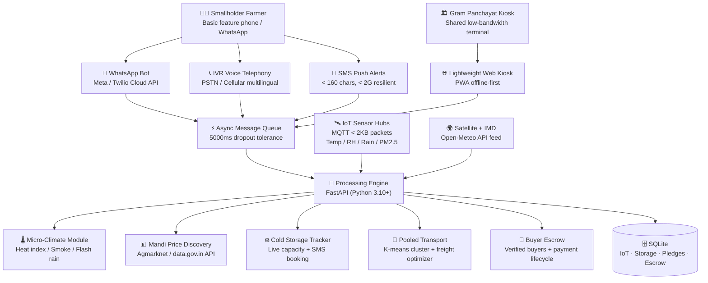

<div align="center">

# 🌾 Rural Panchayat Climate Resilience & Market Access System

### SEVA FIRST Innovation Challenge 2026 — Sewa Sankalp Abhiyan (AICTE / MoE / DTU)

**A zero-barrier, multilingual platform that protects smallholder farmers from two simultaneous attacks: unpredictable climate hazards and exploitative market blind spots.**


🏆 **Built for SEVA FIRST Innovation Challenge 2026 (sfic.co.in · mic.gov.in)**  
**Track:** Technology Solution | **Theme:** Samriddh Annadata (Prosperous Farmer)

[Problem](#-the-dual-vulnerability-problem) · [Solution](#-the-solution) · [Architecture](#-architecture) · [Regions](#-target-regions) · [Getting Started](#-getting-started) · [API](#-api-reference) · [75-Day Plan](#-75-day-work-plan)

</div>

---

## 🎯 The Dual Vulnerability Problem

Small farmers in rural India are squeezed from **two sides at once**:

### 1. Weather & Health Hazards (Pre-Harvest)
Farmers and outdoor farmworkers get blindsided by sudden unseasonal rain, extreme heatwaves, and thick crop-residue smoke — with no hyper-local warnings in time:
- **April–May** wheat harvesting: Heatwaves cause acute heatstroke risk for harvest crews and grain shrinkage.
- **October–November** paddy-to-wheat transition: Thick smog from stubble burning blankets villages, creating severe respiratory hazards.
- **Unseasonal Mavtha rains** in Nashik/Lasalgaon: Harvested onions drying in open panchayat threshing floors get soaked and rot within days.

### 2. Market Blindness (Post-Harvest)
Once crops are harvested, smallholders operate completely in the dark:
- **No real-time mandi prices:** A local trader offers ₹12/kg when the town mandi 40 km away pays ₹20/kg.
- **No cold storage visibility:** In Agra (potato) or Nalanda, facilities fill up unexpectedly and farmers dump crops at rock-bottom rates before they rot.
- **No pooled logistics:** A farmer with only 10–15 quintals cannot justify the fuel cost of hiring an entire truck alone.

### The Result
> Smallholders lose up to **30% of their hard-earned income** through distress sales to middlemen who exploit these exact information blind spots.

---

## 💡 The Solution

A **lightweight, multilingual platform** accessible via **WhatsApp, SMS, IVR voice calls, and a low-bandwidth Panchayat kiosk** — designed for patchy `< 2G` village networks with **zero app download** required.

| Module | What it does | Delivery Channel |
|---|---|---|
| 🌡️ **Micro-Climate & Worker Safety** | Ground IoT sensor telemetry fused with satellite data; heatwave crew alerts; stubble smoke & open drying yard rain warnings | Voice / SMS Push |
| 📊 **Live Mandi Price Discovery** | Real-time APMC prices via Agmarknet; farmgate vs. regional mandi price arbitrage calculator | WhatsApp Bot |
| ❄️ **Cold Storage Locker Hub** | Live available capacity telemetry across pilot belt facilities; SMS-confirmed booking tokens | Light Web / SMS |
| 🚚 **Pooled Village Transport** | K-means clustering of smallholder harvest pledges into shared trucks; 30% freight savings | Panchayat Kiosk |
| 🤝 **Verified Wholesale Escrow** | Direct B2B buyer registry; escrow-backed trade settlements to bypass middlemen | WhatsApp / Web |
| 📱 **Zero-Barrier Delivery** | WhatsApp bot + IVR voice telephony + SMS push; `< 2G` resilient async queue (up to 5000ms dropout tolerance) | All Channels |

---

## 🗺️ Target Regions (4 Agricultural Belts)

### 1. The Indo-Gangetic Plains (Punjab, Haryana, Western UP, Bihar)
- **Hazards:** Stubble smoke October–November; intense heatwaves during April–May wheat harvest; potato cold-storage bottlenecks (Agra UP, Nalanda Bihar).
- **Pilot clusters:** Agra, Nalanda, Ambala.

### 2. Maharashtra Horticulture Belt (Nashik, Pune, Marathwada)
- **Hazards:** Mavtha (unseasonal winter/spring) rain and hailstorms ruining drying onions; wild APMC mandi price swings at Lasalgaon.
- **Pilot clusters:** Nashik, Lasalgaon APMC, Niphad.

### 3. Central India Pulse & Soybean Belt (Madhya Pradesh, Rajasthan)
- **Hazards:** Harvest-time rain discolors soybeans, mustard, and chickpeas (chana); middleman dependence due to distant regional mandis.
- **Pilot clusters:** Indore (Malwa), Bundelkhand, Jaipur.

### 4. Eastern & Southern Vegetable Clusters (Karnataka, Andhra Pradesh, West Bengal)
- **Hazards:** Tomatoes and leafy greens with shelf-life measured in hours; lack of real-time buyer demand tracking forces roadside dumping.
- **Pilot clusters:** Kolar (Karnataka), Madanapalle (Andhra Pradesh).

---

## 🏗 Architecture



---

## 🔬 Technical Specifications

| Component | Technical Implementation | Impact Target |
|---|---|---|
| **IoT Sensor Node** | MQTT-based protocol, payloads kept `< 2 KB`; NEMA-rated weather-proof enclosure | ₹1,500/unit edge hardware node |
| **Micro-Climate Advisory** | Satellite data + ground sensor telemetry pushed via Voice/SMS | Reduce heatstroke & crop loss |
| **Mandi Price Discovery** | Real-time Agmarknet feed integration with price arbitrage calculator | Eliminate middleman distortion |
| **Cold Storage Tracking** | Live capacity telemetry & SMS-based booking reservation | Prevent post-harvest decay |
| **Pooled Transport** | K-means geographic clustering matching farm outputs with available truck tonnages | Direct 30% freight cost reduction |
| **Low-Bandwidth Adaptation** | Asynchronous Protocol Synchronization tolerating dropouts up to 5,000 ms | `< 2G` rural network resilience |
| **Direct Buyer Escrow** | Registry of verified wholesale buyers with escrow-backed trade settlements | Guarantee fair payment |

---

## 🛠 Tech Stack

| Layer | Technology |
|---|---|
| **Frontend** | React 19, Vite, Tailwind CSS v4, Recharts, GSAP, react-i18next, vite-plugin-pwa |
| **Backend** | Python 3.10+, FastAPI, Uvicorn, Pydantic v2, httpx |
| **IoT / Edge** | MQTT-compatible HTTP telemetry ingestion, `< 2 KB` packet schema |
| **AI / NLP** | Groq LLM advisory, Bhashini + MyMemory regional translation (11 Indian languages) |
| **Delivery Gateways** | WhatsApp Business API (Twilio/Meta), Twilio IVR (TwiML), SMS plain-text push |
| **Geo & Data** | OpenStreetMap Nominatim + Overpass, Open-Meteo, Agmarknet (`data.gov.in`) |
| **Persistence** | SQLite (`iot.db`, `cold_storage.db`, `transport.db`, `escrow.db`, `session.db`) |
| **Testing** | pytest & pytest-asyncio — comprehensive unit and integration test suite |

---

## 🚀 Getting Started

### Option 1 — Docker Compose (recommended)

```bash
git clone https://github.com/tan8696/Fingrow-.git
cd Fingrow-
cp backend/.env.example backend/.env
docker compose up --build
```

- Frontend → http://localhost:5173
- API docs (Swagger) → http://localhost:8000/docs

### Option 2 — Run locally

**Backend**
```bash
cd backend
python -m venv venv
source venv/Scripts/activate      # Windows: venv\Scripts\activate
pip install -r requirements.txt
cp .env.example .env
uvicorn app.main:app --reload --port 8000
```

**Frontend**
```bash
cd frontend
npm install
npm run dev                       # http://localhost:5173
```

---

## 📡 API Reference

### Core Agricultural Platform Endpoints

| Area | Endpoint | Description |
|---|---|---|
| **IoT & Micro-Climate** | `POST /api/iot/telemetry` | Ingest IoT node packet (`< 2 KB`); returns immediate health alert |
| **IoT & Micro-Climate** | `GET /api/iot/readings?district=` | Retrieve latest IoT readings for a district |
| **IoT & Micro-Climate** | `GET /api/weather/microclimate?district=` | Fused satellite + ground IoT micro-climate advisory |
| **Cold Storage** | `POST /api/cold-storage/search` | Search available cold storage facilities near district/state |
| **Cold Storage** | `POST /api/cold-storage/reserve` | Reserve cold storage locker with SMS booking token |
| **Pooled Transport** | `POST /api/logistics/pledge` | Register smallholder harvest pledge into pooling queue |
| **Pooled Transport** | `POST /api/logistics/pools` | K-means cluster grouping and 30% freight savings calculation |
| **Mandi Arbitrage** | `POST /api/mandi/arbitrage` | Farmgate vs. regional APMC net income comparison |
| **Buyer Escrow** | `POST /api/buyers/search` | Search verified wholesale B2B buyers |
| **Buyer Escrow** | `POST /api/escrow/trade` | Initiate direct escrow trade order |
| **Buyer Escrow** | `POST /api/escrow/advance` | Advance trade through lifecycle (`pending` → `funded` → `released`) |
| **Delivery Gateways** | `POST /api/gateways/whatsapp` | WhatsApp bot webhook handler (Twilio/Meta compatible) |
| **Delivery Gateways** | `POST /api/gateways/ivr` | IVR voice telephony request handler (TwiML) |
| **Delivery Gateways** | `GET /api/gateways/sms-test` | Test plain-text SMS `< 160-character` alert formatting |

---

## 📅 75-Day Work Plan & Milestone Schedule

| Phase | Duration | Scope & Milestones |
|---|---|---|
| **Phase 1: Requirements & Architecture** | **Days 1–15** | Finalize multilingual voice/SMS workflow architecture; partner with local FPOs/village panchayats; map regional mandi and cold-storage data sources. |
| **Phase 2: Platform Development** | **Days 16–40** | Assemble IoT micro-climate sensor nodes; build lightweight web, WhatsApp bot, and voice-call IVR interface; integrate micro-climate feeds and mandi price dashboards. |
| **Phase 3: Field Testing & User Trials** | **Days 41–60** | Deploy prototype within pilot village cluster; run live user trials with farmers and local cooperatives; refine voice/SMS accessibility based on feedback. |
| **Phase 4: Evaluation & Scaling Setup** | **Days 61–75** | Measure pilot impact on post-harvest savings; finalize documentation; prepare rollout roadmap for neighbouring panchayats. |

**Entry TRL:** TRL 3 (Analytical and experimental proof of concept demonstrated)  
**Target TRL:** TRL 6 (Fully functional kiosk and sensor hub live in pilot village)

---

## 👥 Team Composition & Roles

| Member Role | Focus & Responsibilities |
|---|---|
| **Project Lead / Strategy** | Oversees overall project execution, panchayat partnerships, and stakeholder alignment. |
| **Full-Stack & Mobile Developer** | Builds lightweight web platform, WhatsApp bot integration, and low-bandwidth UI. |
| **AI / Voice Integration Engineer** | Handles speech-to-text, multi-language translation, and IVR/SMS voice pipelines. |
| **Field Outreach & Testing Lead** | Manages on-ground user trials, farmer training, and feedback collection within rural clusters. |

---

## 💰 Prototype Cost & Economic Viability

| Component | Estimated Cost |
|---|---|
| Edge Hardware Node (IoT sensor suite + microcontroller) | ₹1,500 per unit |
| WhatsApp Business API & IVR Gateway subscriptions | ~₹0.12 per advisory push |
| Minimal Cloud Hosting | ₹2,000 / month |
| **Total Prototype Pilot (1 Panchayat cluster)** | **~₹50,000** |

**Tangible Benefit:** Up to 30% increase in smallholder farm revenue, saving **₹15,000 to ₹25,000 yearly per farming household** through direct market access, optimized cold-storage tracking, and pooled logistics.
